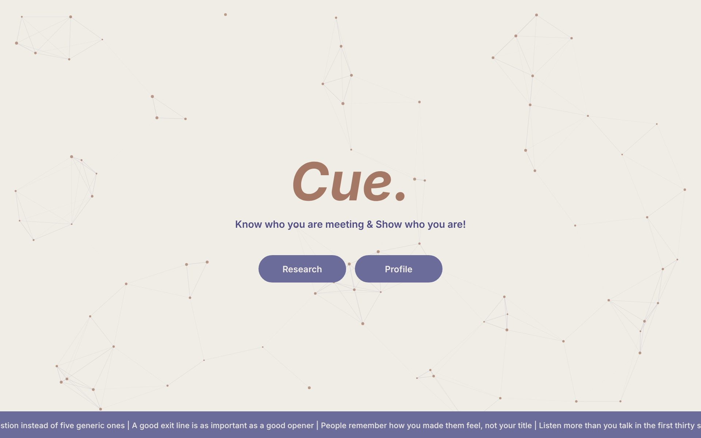
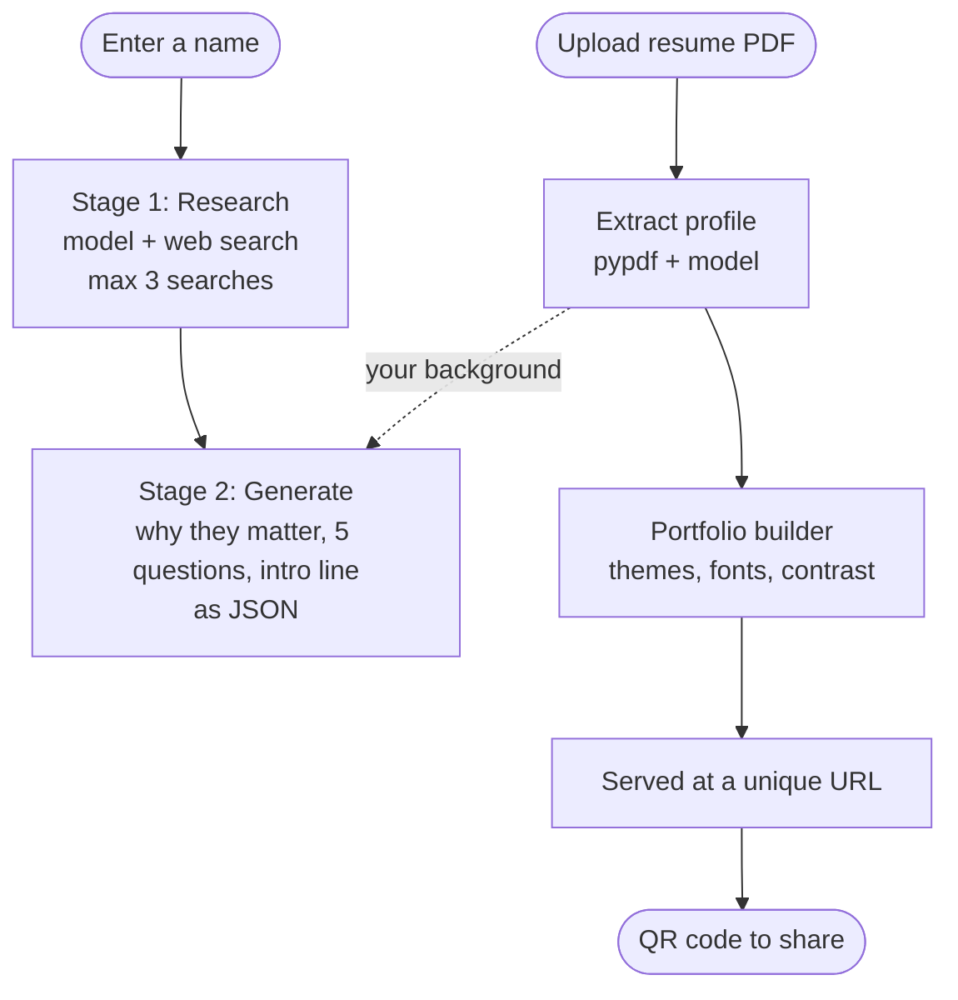

# Cue

**Know who you are meeting. Show who you are.**


Cue is a networking toolkit for conferences and professional events. Enter a name and get live research on who you're about to meet, five tailored conversation questions and an intro line you can actually say out loud. Upload your resume and Cue builds a personal portfolio site you can customize and share with a QR code.

**[Try the live demo](https://cue-sepia-omega.vercel.app)**



## The Problem

At a conference you get a few seconds with people you've only seen on a schedule. Most attendees either skip the conversation or open with "so, what do you do?" Looking someone up on your phone in the hallway takes too long, and a business card doesn't show anything you've built. Cue does the research in one step and gives you a link to your work that you can share by letting someone scan your screen.

## Features

- **Live research on any person:** a web search for their current role, recent work and why they matter in their field
- **Five tailored questions:** specific and relaxed, based on their recent projects and focus area
- **A personal intro line:** a first person opener that connects your background to their work, when you've uploaded a resume
- **Resume to profile:** upload a PDF and get structured data back (name, role, experience, projects, skills, links)
- **Auto generated portfolio site:** hero, about, skills, experience, projects and contact sections
- **15+ themes and 10 fonts:** change the look and regenerate in one click
- **QR code sharing:** a scan to open link that updates when you change the theme or font
- **Opt in saving:** your profile is saved to this browser only if you choose to

## Tech Stack

| Layer | Technology |
|---|---|
| Frontend | React 19, Vite, Tailwind CSS plus custom CSS |
| Backend | Python, FastAPI, pypdf |
| AI | Anthropic Claude API with the web search tool |
| Hosting | Vercel (frontend), Railway (backend) |

## How It Works



**Person research** runs in two stages. First the model searches the web and returns structured findings (role, company, recent work, reputation). Then a second call turns those findings into a JSON profile. If you've uploaded a resume, your background is woven into the intro line only where there's real overlap.

**Resume to portfolio** extracts your profile from the PDF, builds a themed HTML portfolio on the backend, and serves it at a unique link. Changing the theme or font rebuilds it, and the QR code always points to the latest version.

## Key Decisions

- **Two calls instead of one.** Searching and writing are separate steps, so the questions and intro line are based only on what the search actually found, in a fixed JSON shape the frontend can rely on.
- **Web search is capped at 3 searches per person.** That keeps each lookup fast and the API cost predictable.
- **Safe file IDs.** Portfolios and resumes are saved under random 8 character IDs, and every request checks the ID format first. That blocks path tricks like `../` from reading other files on the server.
- **Privacy first by default.** Nothing about you is kept in the browser unless you turn saving on, and you can clear it at any time.
- **CORS allows only known origins:** localhost for development and the Vercel domain in production.

## Running Locally

### Backend

```bash
cd backend
python3 -m venv venv
source venv/bin/activate
pip install -r requirements.txt
```

Create `backend/.env`:

```env
ANTHROPIC_API_KEY=your_key_here
```

Start the API:

```bash
uvicorn main:app --reload --port 8000
```

The API runs at http://127.0.0.1:8000.

### Frontend

```bash
cd frontend
npm install
npm run dev
```

The app runs at http://localhost:5173. For local development, set `apiBase` in `frontend/src/App.jsx` to `http://127.0.0.1:8000`, and switch it back to the Railway URL before deploying.

## API Endpoints

| Method | Endpoint | What it does |
|---|---|---|
| POST | `/api/research` | Research a person by name and return questions and an intro line |
| POST | `/api/extract-resume` | Upload a PDF resume and get structured profile data |
| POST | `/api/generate-portfolio` | Build a portfolio from profile data, theme and font |
| GET | `/api/portfolio/{id}` | View a generated portfolio |
| GET | `/api/resume/{id}` | Download the resume linked from a portfolio |

---

Built solo in under two weeks.
